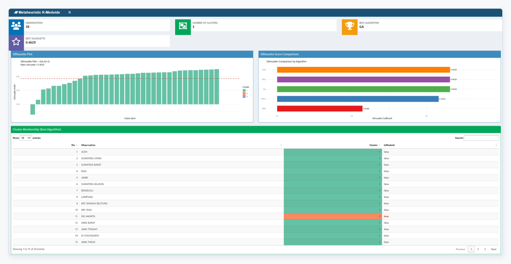

# Metaheuristic-Optimized K-Medoids Clustering of Indonesian Provinces (EQI 2023)

Code, data and results for the manuscript *“Metaheuristic-Optimized K-Medoids Clustering of Indonesian Provinces Based on Environmental Quality Index Components”* (CommIT Journal, article 16202).



## Contents

| Folder | What it contains |
|---|---|
| `R/CommIT_16202_Revision_Experiments.R` | Main pipeline: preprocessing (Mahalanobis D², VIF), PAM baseline, exhaustive global optimum (k = 2–6), equal-budget benchmark of GA, PSO, CSA, GWO and random search (3,000 fitness evaluations, 30 runs, k = 2–10), nominal-budget runs, sensitivity analysis, leave-one-province-out stability (ARI), DBI/CH, figures and map |
| `R/CommIT_16202_S1_EQI2022.R` | Supplementary S1: replication of the full protocol on EQI 2022 (34 provinces) |
| `R/CommIT_16202_S2_Moran.R` | Supplementary S2: global Moran’s I of the 2023 components (k-nearest-neighbour weights, 9,999 permutations) |
| `data/` | BPS tables *Komponen Penyusun Indeks Kualitas Lingkungan Hidup Menurut Provinsi* (2022 and 2023) |
| `results/main/` | CSV outputs of the main pipeline (E0–E8, Tables 2 and 4); these are the outputs behind every number in the manuscript |
| `results/reproducibility_check.csv` | File-by-file comparison with a second, independent run: identical except wall-clock runtimes |
| `results/supplementary/` | CSV outputs of S1 (EQI 2022) and S2 (Moran’s I) |
| `figures/` | Figures used in the manuscript (PNG) |
| `shiny/app.R` | Interactive R Shiny decision-support application (English interface) |
| `shiny/check_shiny_decoding.R` | Test that every optimizer in the app returns the medoid set that produced the reported Silhouette (stops on failure) |
| `shiny/check_shiny_decoding_log.*` | Log of the passing test run |

## How to reproduce

1. Install R ≥ 4.4 and the packages `cluster`, `GA`, `pso`, `clusterCrit`, `ggplot2`, `sf`, `spdep`.
2. Set the input paths at the top of each script, or run the scripts on Kaggle with the inputs under `/kaggle/input` (they are then found automatically):
   - `PATH_CSV` – the BPS table in `data/` (2023 for the main script and S2, 2022 for S1).
   - `PATH_SHP` – a province boundary shapefile of Indonesia with **38 provinces** (2022 division; a 34-province file also works, the four new Papua provinces are then merged into their parent provinces). Used only for the map (Fig. 3). The run reported in the paper used the Kaggle input `shapefile-indo`. Province names are matched to the BPS names strictly; if any name does not match, the script writes `E10_map_name_matching_report.csv` and skips the map, all other results are unaffected.
   - `PATH_XY` – used only by the S2 Moran’s I script: a table of regency/city centroids with the columns `PROV_2024`, `X_Centroid` (longitude) and `Y_Centroid` (latitude) (Kaggle input `xy-centroid`). The province location is the mean of the centroids of its regencies and cities. The resulting 38 province coordinates are distributed in `results/supplementary/supp_S2_coordinates.csv`; when the centroid file is not available, the S2 script uses this file directly, so Moran’s I can be reproduced from the repository alone.
3. Run `R/CommIT_16202_Revision_Experiments.R` (about 40 minutes on a Kaggle CPU notebook), then the S1 and S2 scripts.

Every run of every optimizer uses seed 42 + r (r = 1, …, 30). The fitness is the mean Silhouette with nearest-medoid assignment; its vectorized implementation is checked against `cluster::silhouette` before any experiment runs. Silhouette values are rounded to 10 decimal places before the Friedman and Wilcoxon tests, so that equivalent medoid sets are treated as ties.

## Run the Shiny app locally

The app uses the same preprocessing, decoder and optimizers as the benchmarking script and stores each medoid set together with the Silhouette it produced (no re-decoding of the final solution). `Rscript shiny/check_shiny_decoding.R` (run from the repository root) verifies this on the 2023 data: it runs GA, PSO, CSA and GWO for k = 3 and 5 with five seeds, recomputes the Silhouette from the returned medoids, stops with an error if any difference exceeds 10⁻⁹, and writes `shiny/check_shiny_decoding_log.csv` and `shiny/check_shiny_decoding_log.txt` (result, date, session info).


```r
install.packages(c("shiny", "shinydashboard", "DT", "ggplot2", "cluster", "GA", "pso", "clusterCrit", "dplyr", "tidyr"))
shiny::runApp("shiny")
```

Online version: https://triutami.shinyapps.io/myshinyapp/

## Data source

Badan Pusat Statistik (Statistics Indonesia), *Komponen Penyusun Indeks Kualitas Lingkungan Hidup Menurut Provinsi*, 2022 and 2023, https://www.bps.go.id/id/statistics-table/2/MjUzMiMy/komponen-penyusun-indeks-kualitas-lingkungan-hidup-menurut-provinsi.html

## Citation

Please cite the article once published (CommIT Journal, article ID 16202).
